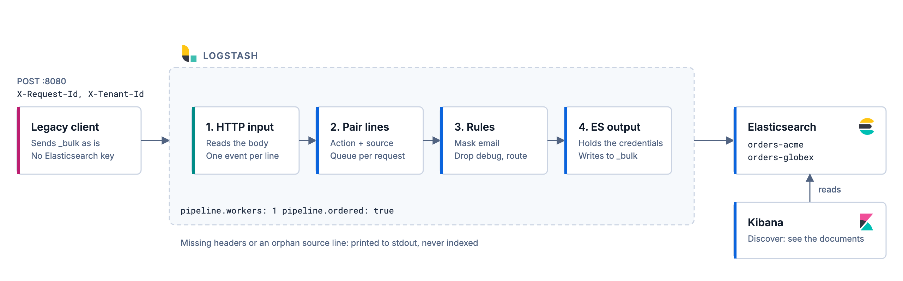
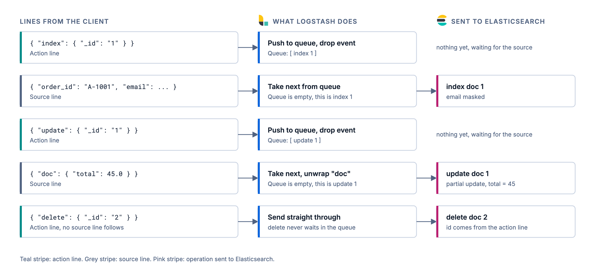

# Logstash bulk gateway

A small Logstash pipeline that sits in front of Elasticsearch and accepts `_bulk` requests from a client you can't change.

The client sends a normal bulk body. Logstash does four things before anything reaches Elasticsearch:

- masks the email address in every document
- drops `debug` events
- routes each request to a per-tenant index, based on a header
- keeps the Elasticsearch credentials, so the client never sees them

This repo goes with the Elastic Search Labs article on processing Bulk API requests with Logstash.



## What you need

- Docker with Compose v2
- `curl` and `jq`
- About 4 GB of free memory for the three containers (Elasticsearch, Logstash and Kibana)

Tested with Elasticsearch, Logstash and Kibana 9.5.6.

## Run it

Start the stack:

```sh
docker compose up -d
```

Wait until Logstash answers on its monitoring port:

```sh
curl -s localhost:9600 | jq -r .status
```

When it prints `green`, send the sample request:

```sh
./scripts/send.sh
```

Then check the result:

```sh
./scripts/verify.sh
```

You should see six `PASS` lines.

Then try the awkward requests a real bulk client can send:

```sh
./scripts/edge-cases.sh
```

It runs 18 checks and should print 18 `PASS` lines. Requests that should be rejected have to both stay out of Elasticsearch and show up on Logstash's stdout, so a request that never arrived can't pass. It covers:

- bodies sent as `application/json`, and documents without an `_id`
- documents with their own `url`, `host`, `event` and `tags` fields
- a client `@timestamp` as an ISO string (kept), as epoch milliseconds (converted), and as something else (rejected)
- a client putting its own `@metadata` in a document
- an invalid tenant name, and an update with `script` or `doc_as_upsert`
- an update that keeps the original `@timestamp`, and one that sends a new one
- a mapping error, which is not indexed and lands in the dead letter queue

If port 8080 is already used on your machine, pick another one and use it for both steps:

```sh
export LOGSTASH_PORT=8088
docker compose up -d
./scripts/send.sh
```

## Look at the documents in Kibana

Kibana starts with the stack. It takes a minute or so the first time.

1. Open http://localhost:5601 and log in with user `elastic` and password `changeme`.
2. Go to **Discover**, and when it asks, create a data view with the index pattern `orders-*` and `@timestamp` as the time field.
3. You'll see the documents the gateway wrote. Check that `email` is masked, that `total` is 45 on `A-1001`, and that there's no document for the `debug` event.

Send the sample as another tenant and refresh Discover to see `orders-globex` show up in the same data view.

## What the sample request does

The body is [sample/bulk-acme.ndjson](sample/bulk-acme.ndjson). It has five lines, and the client doesn't tell Elasticsearch which index to use.

| Operation | What you should see afterwards |
| --- | --- |
| index doc 1 | exists, email is `j***@example.com` |
| create doc 2 | created, then deleted by the last line, so it's gone |
| index doc 3 (level `debug`) | never stored, the pipeline drops it |
| update doc 1 | `total` is 45, and there is no nested `doc` field |
| delete doc 2 | returns 404 |

Everything lands in `orders-acme`, because the script sends `X-Tenant-Id: acme`. Send the same file as another tenant and you get a second index:

```sh
./scripts/send.sh sample/bulk-acme.ndjson globex
curl -s -u elastic:changeme "localhost:9200/_cat/indices/orders-*?v"
```

## How the pairing works

A bulk body is not one JSON document. It's lines, and most operations take two of them: an action line, then a source line. Logstash's `json_lines` codec turns every line into its own event, so the link between the two is lost.

The pipeline puts it back. It keeps a small queue per request ID. An action line goes into the queue and is dropped. The next source line takes the oldest waiting action and inherits its operation and ID. A `delete` has no source line, so it skips the queue.



This only works if events are handled in order, one at a time. That's why [config/logstash.yml](config/logstash.yml) sets `pipeline.workers: 1` and `pipeline.ordered: true`.

## Try breaking it

Send a request without the headers:

```sh
curl -s -X POST localhost:8080/ -H 'Content-Type: application/x-ndjson' --data-binary @sample/bulk-acme.ndjson
docker compose logs logstash | grep missing_headers
```

Logstash prints the events with a `missing_headers` tag. Nothing is written to Elasticsearch. The same happens, with their own tags, for an invalid tenant name (`invalid_tenant`), an `update` or `delete` without an `_id` (`missing_id`), an update that isn't a plain `{ "doc": ... }` (`unsupported_update`), and a source line with no action line before it (`orphan_source_line`).

Look at how a failed request looks to the client. It still gets a plain `ok` back, whatever happened to its documents:

```sh
curl -si -X POST localhost:8080/ -H 'Content-Type: application/x-ndjson' -H 'X-Request-Id: x' -H 'X-Tenant-Id: Not/Valid' --data-binary $'{ "index": { "_id": "1" } }\n{ "a": 1 }\n'
```

Now try more than one worker. Set `pipeline.workers: 2` in `config/logstash.yml` and restart Logstash:

```sh
docker compose up -d --force-recreate logstash
docker compose logs logstash | grep "requires the use of a single pipeline worker"
```

Logstash refuses to start. Set it back to `1` after.

## Files

| File | What it is |
| --- | --- |
| [docker-compose.yml](docker-compose.yml) | Elasticsearch (security on), Kibana and Logstash |
| [pipeline/bulk-gateway.conf](pipeline/bulk-gateway.conf) | The whole pipeline |
| [config/logstash.yml](config/logstash.yml) | Worker and ordering settings, and the dead letter queue |
| [sample/bulk-acme.ndjson](sample/bulk-acme.ndjson) | The test bulk body |
| [scripts/send.sh](scripts/send.sh) | Posts a bulk file with the two headers |
| [scripts/verify.sh](scripts/verify.sh) | Checks the final state in Elasticsearch |
| [scripts/edge-cases.sh](scripts/edge-cases.sh) | Sends the awkward requests and checks each result |
| [docs/](docs) | The two diagrams as PNG, with the editable SVG sources, and the [logos](docs/logos/NOTICE.md) they use, with their source and trademark note |

## Things to know

**What this works with**

- It works for clients that only look at the status code, like `curl`, scripts and vendor tools. The official Elasticsearch clients won't work. They check that the server is Elasticsearch, and once Logstash accepts the body, the gateway answers with a plain-text `ok` and no `X-Elastic-Product` header. With the Python client 9.5.1 it raises `UnsupportedProductError`. The request still goes through, so the client reports an error for data that was written, and a retry can create duplicates for documents without an `_id`. See [Automatic product check](https://www.elastic.co/docs/reference/elasticsearch/clients/javascript/connecting#product-check) in the JavaScript client docs.
- The http input can only answer `200`, `201`, `202` or `204` for an accepted request. It answers `429` when Logstash is backed up, and it rejects bodies over `max_content_length`, which is 100 MB by default. A client never sees which documents failed. A `200` means Logstash received the body, not that Elasticsearch indexed it.
- An `update` has to be a plain `{ "doc": { ... } }`. `script`, `upsert`, `doc_as_upsert` and the other update options are rejected, because they can't be sent through the output as is.
- These bulk details are ignored: the `_index` the client sends, `routing`, `if_seq_no` and `if_primary_term`, a per-action `pipeline`, URL parameters like `?refresh`, and an index in the path (`/my-index/_bulk`).
- A client `@timestamp` in ISO 8601 is kept, and epoch milliseconds are converted, which is what Elasticsearch accepts too. Anything else is rejected. On an update, `@timestamp` is left alone unless the client sends one. A client `tags` field is kept as it is, except an object, which Logstash can't keep and the gateway rejects.
- Anything a client puts under its own `@metadata` key is removed before the pipeline runs, because Logstash would otherwise merge it into the event.
- An action line is found by its shape. A document with a top-level field named `index`, `create`, `update` or `delete` that holds an object looks like an action line.

**Tenants and trust**

- The tenant comes from `X-Tenant-Id`, and the request ID from `X-Request-Id`. Tenant isolation only holds if your proxy sets both headers from an authenticated identity, overwrites anything the client sent, and clients can't reach the Logstash port directly. The http input has no authentication unless you set `user` and `password`, or TLS client certificates.
- The tenant name is checked against `^[a-z0-9_-]{1,64}$`, because it becomes part of an index name.
- The queue key is the tenant plus the request ID, so two tenants that reuse a request ID can't mix their queues. Two requests from the same tenant that share one still will.

**Errors, and where they go**

- A document Elasticsearch rejects with a `400` or `404`, like a mapping error, goes to the dead letter queue. It's turned on in `config/logstash.yml`, and it's written to disk every few seconds. A `409` conflict is logged and dropped. Other errors, like `429`, are retried until they succeed, which stalls the single worker. See the [output plugin docs](https://www.elastic.co/docs/reference/logstash/plugins/plugins-outputs-elasticsearch#_retry_policy).
- To look at the dead letter queue: `docker compose exec logstash sh -c 'cat /usr/share/logstash/data/dead_letter_queue/main/*.log | grep -a -c BAD-MAPPING'`.
- The [failure store](https://www.elastic.co/docs/manage-data/data-store/data-streams/failure-store) is an Elasticsearch feature that catches mapping and ingest failures inside a data stream. It belongs to a data stream, and data streams only take new documents through `create`. This gateway also does `index`, `update` and `delete` on regular indices, so it isn't used here. It doesn't capture backpressure, security errors or version conflicts either.

**Limits**

- One worker means this doesn't scale across CPU cores on one node. Run several independent pipelines if you need more, split by tenant.
- Ordered in Logstash isn't ordered end to end. The output retries only the actions that failed, so an `update` can reach Elasticsearch before a retried `index` of the same document.
- `aggregate_maps` in the stats API doesn't fall back to 0 right away. Finished requests keep their queue until the inactivity timeout clears it, which takes five to seven minutes after the last request. The cleanup runs on an interval, so it can come a couple of minutes after the 300 second timeout. The two aggregate filters are named `queue_push` and `queue_pop` in the stats.
- The aggregate timeouts are `timeout => 3600` and `inactivity_timeout => 300`, on purpose. If Elasticsearch is slow, the single worker can sit in the output between an action line and its source line, and a queue that expires in between turns the source line into an orphan. With 30 seconds, a 50 second Elasticsearch stall lost a document in a test. An open queue only costs memory.
- The aggregate queues live in memory. With the persistent queue on, a crash can replay source lines whose action lines were already processed, and those become orphans. The settings are commented out in `config/logstash.yml`.
- Masking only covers a top-level `email` field (a string, or a list of strings), and it keeps the domain. It isn't full PII redaction.
- The password in this repo is `changeme` for both `elastic` and Kibana's service user, and TLS is off. It's for trying things out only.
- Elasticsearch ingest pipelines can mask and route bulk data too. Use those if that's all you need. This gateway makes sense when the client must not know Elasticsearch exists, or you need to enrich from other sources or write to more than one place.

## Clean up

```sh
docker compose down -v
```
